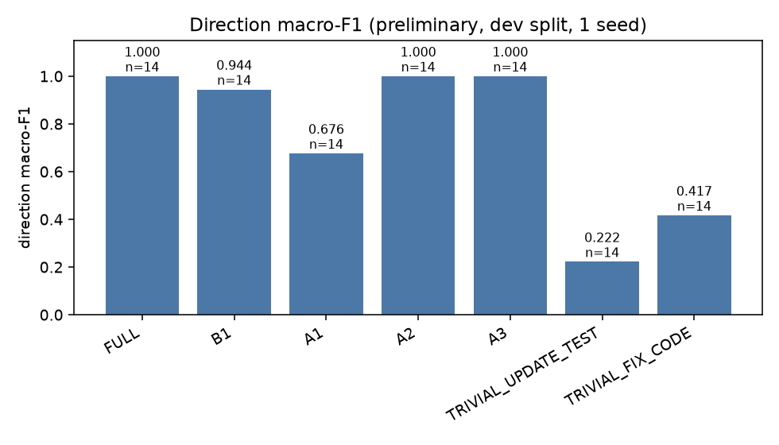
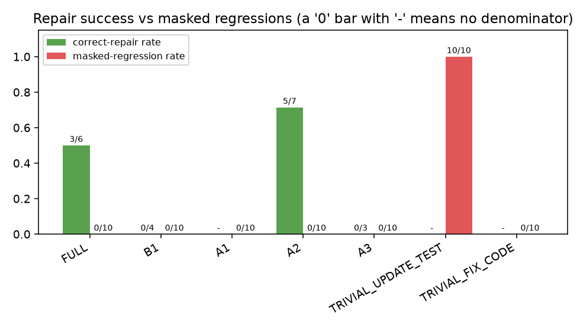
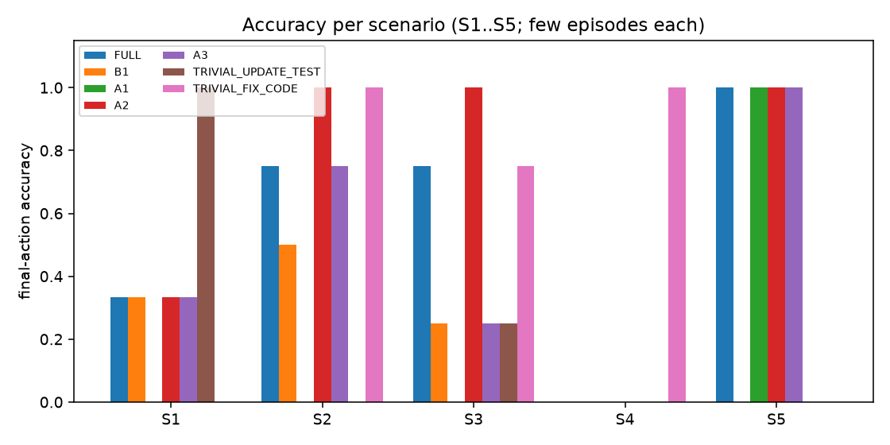

# Results table, pilot-dev-5cond

**Preliminary.** Raw counts are shown next to each rate. `-` means not computable (never 0). A condition that has not run is marked *not yet evaluated*. Execution failures (API/tool errors) are counted apart and never scored.

| Condition | Episodes run | Execution failures | Direction macro-F1 | Direction accuracy | Correct-repair rate | Masked regressions |
|---|---|---|---|---|---|---|
| FULL | 9 | 0 | 1.000 | 14/14 (1.00) | 3/6 (0.50) | 0/10 (0.00) |
| B1 | 9 | 0 | 0.944 | 12/14 (0.86) | 0/4 (0.00) +2 unverifiable | 0/10 (0.00) |
| A1 | 9 | 0 | 0.676 | 11/14 (0.79) | - | 0/10 (0.00) |
| A2 | 9 | 0 | 1.000 | 14/14 (1.00) | 5/7 (0.71) | 0/10 (0.00) |
| A3 | 9 | 0 | 1.000 | 14/14 (1.00) | 0/3 (0.00) +3 unverifiable | 0/10 (0.00) |
| TRIVIAL_UPDATE_TEST | 9 | 0 | 0.222 | 4/14 (0.29) | - | 10/10 (1.00) |
| TRIVIAL_FIX_CODE | 9 | 0 | 0.417 | 10/14 (0.71) | - | 0/10 (0.00) |

- Split `dev` (9 episodes), dataset `pilot@87d1398471c0`; seeds [0]; model(s): gemini-3.5-flash-lite.
- One seed and a small episode set: not a statistical comparison.
- `mutant_kill_retention` is not computed on these runs (the reference tests kill none of the cached mutants).
- Integrity audit, A1: 0 accepted repair(s) in 9 run(s); weakened 0/0 measured test patches; 0 accepted on the wrong side; 0 not fully measured
- Integrity audit, A2: 6 accepted repair(s) in 9 run(s); weakened 0/2 measured test patches; 0 accepted on the wrong side; 1 not fully measured
- Integrity audit, A3: 4 accepted repair(s) in 9 run(s); weakened 0/2 measured test patches; 0 accepted on the wrong side; 1 not fully measured
- Integrity audit, B1: 4 accepted repair(s) in 9 run(s); weakened 0/3 measured test patches; 0 accepted on the wrong side; 1 not fully measured
- Integrity audit, FULL: 4 accepted repair(s) in 9 run(s); weakened 0/1 measured test patches; 0 accepted on the wrong side; 1 not fully measured
- Integrity audit, TRIVIAL_FIX_CODE: 0 accepted repair(s) in 9 run(s); weakened 0/0 measured test patches; 0 accepted on the wrong side; 0 not fully measured
- Integrity audit, TRIVIAL_UPDATE_TEST: 0 accepted repair(s) in 9 run(s); weakened 0/0 measured test patches; 0 accepted on the wrong side; 0 not fully measured

