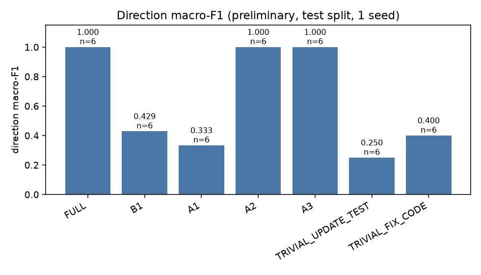
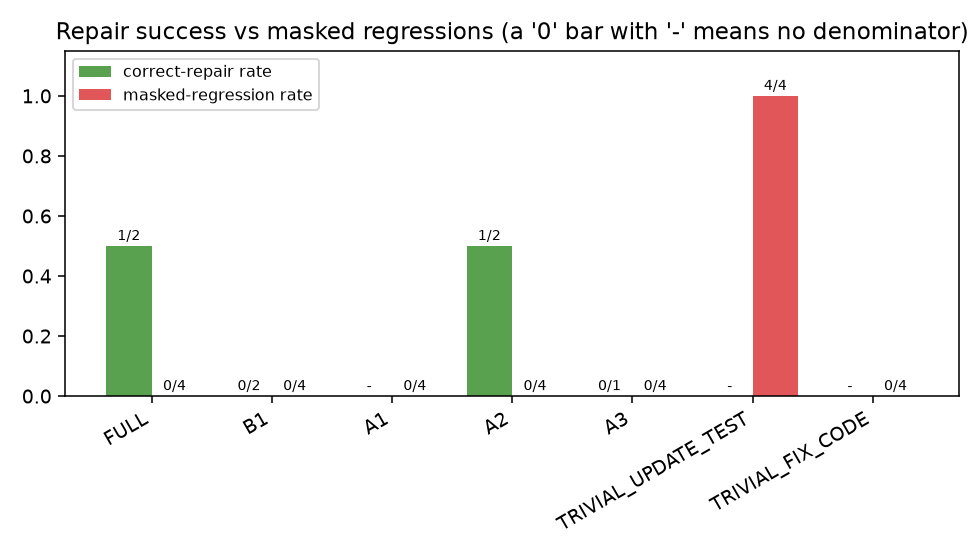
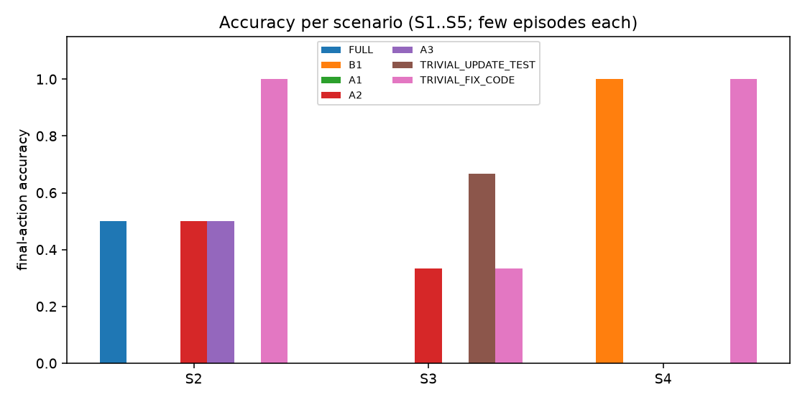

# Results table, pilot-test-5cond

**Preliminary.** Raw counts are shown next to each rate. `-` means not computable (never 0). A condition that has not run is marked *not yet evaluated*. Execution failures (API/tool errors) are counted apart and never scored.

| Condition | Episodes run | Execution failures | Direction macro-F1 | Direction accuracy | Final-action accuracy | Correct-repair rate | Masked regressions |
|---|---|---|---|---|---|---|---|
| FULL | 4 | 0 | 1.000 | 6/6 (1.00) | 0.167 | 1/2 (0.50) | 0/4 (0.00) |
| B1 | 4 | 0 | 0.429 | 3/6 (0.50) | 0.167 | 0/2 (0.00) +1 unverifiable | 0/4 (0.00) |
| A1 | 4 | 0 | 0.333 | 3/6 (0.50) | 0.000 | - | 0/4 (0.00) |
| A2 | 4 | 0 | 1.000 | 6/6 (1.00) | 0.333 | 1/2 (0.50) | 0/4 (0.00) |
| A3 | 4 | 0 | 1.000 | 6/6 (1.00) | 0.167 | 0/1 (0.00) +1 unverifiable | 0/4 (0.00) |
| TRIVIAL_UPDATE_TEST | 4 | 0 | 0.250 | 2/6 (0.33) | 0.333 | - | 4/4 (1.00) |
| TRIVIAL_FIX_CODE | 4 | 0 | 0.400 | 4/6 (0.67) | 0.667 | - | 0/4 (0.00) |

- Split `test` (4 episodes), dataset `pilot@e21791d4fdae`; seeds [0]; model(s): gemini-3.5-flash-lite.
- One seed and a small episode set: not a statistical comparison.
- Mutant-kill retention comes from the post-hoc integrity audit lines below (pooled raw counts; undefined where the reference tests kill no mutant).
- Integrity audit, A1: 0 accepted repair(s) in 4 run(s); weakened 0/0 measured test patches; 0 accepted on the wrong side; 0 not fully measured; mutant-kill retention not measurable
- Integrity audit, A2: 2 accepted repair(s) in 4 run(s); weakened 0/0 measured test patches; 0 accepted on the wrong side; 0 not fully measured; mutant-kill retention not measurable
- Integrity audit, A3: 1 accepted repair(s) in 4 run(s); weakened 0/0 measured test patches; 0 accepted on the wrong side; 0 not fully measured; mutant-kill retention not measurable
- Integrity audit, B1: 1 accepted repair(s) in 4 run(s); weakened 0/0 measured test patches; 0 accepted on the wrong side; 0 not fully measured; mutant-kill retention not measurable
- Integrity audit, FULL: 1 accepted repair(s) in 4 run(s); weakened 0/0 measured test patches; 0 accepted on the wrong side; 0 not fully measured; mutant-kill retention not measurable
- Integrity audit, TRIVIAL_FIX_CODE: 0 accepted repair(s) in 4 run(s); weakened 0/0 measured test patches; 0 accepted on the wrong side; 0 not fully measured; mutant-kill retention not measurable
- Integrity audit, TRIVIAL_UPDATE_TEST: 0 accepted repair(s) in 4 run(s); weakened 0/0 measured test patches; 0 accepted on the wrong side; 0 not fully measured; mutant-kill retention not measurable

